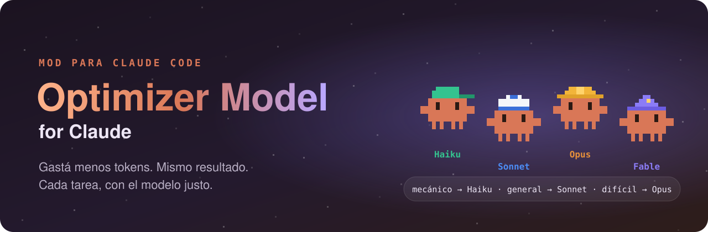
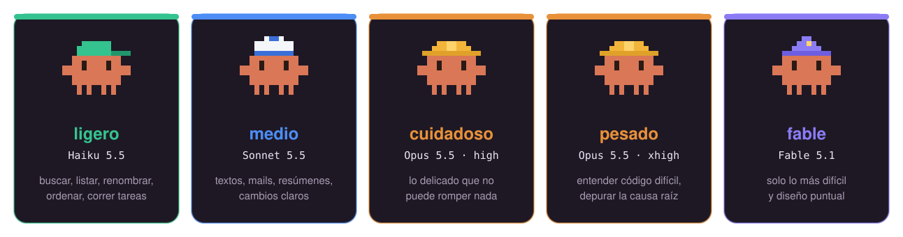
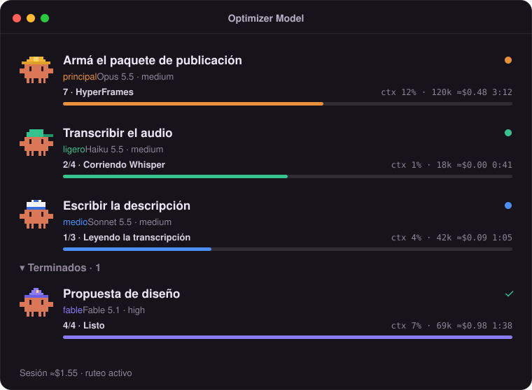

<p align="center">
  
</p>

<p align="center">
  
  
  
  
</p>

<p align="center">
  <b>Un mod para Claude Code que manda cada tarea al modelo justo</b><br>
  Lo mecánico a <b>Haiku</b>, lo general a <b>Sonnet</b>, lo difícil a <b>Opus</b>, y un panel con muñecos Claude para ver quién trabaja en cada momento.
</p>

<p align="center">
  <a href="#-instalar">Instalar</a> ·
  <a href="#-qué-hace">Qué hace</a> ·
  <a href="#-los-obreros">Los obreros</a> ·
  <a href="#-el-panel">El panel</a> ·
  <a href="#-comandos">Comandos</a>
</p>

---

## 💡 El problema

Usar el modelo más potente para todo es como mandar al ingeniero jefe a renombrar archivos: **funciona, pero sale carísimo.** Buscar, listar, ordenar archivos o correr una tarea repetida no necesita el modelo más caro. Programes, escribas, investigues o armes tu negocio, pasa lo mismo. Y cuando bajás de modelo a mano, a veces el resultado sale mal y gastás el doble en arreglarlo.

**Optimizer Model for Claude** decide por vos qué modelo va en cada tarea: barato donde alcanza y potente donde hace falta.

## ⚡ Instalar

En Claude Code (terminal):

```
/plugin install optimizer-model --marketplace zurdoar/optimizer-model-for-claude
```

Respondé `y` para agregar el marketplace y elegí el alcance **user**: así queda activo en **todos tus chats**.

<details>
<summary><b>Otras formas de instalarlo</b></summary>

Desde una consola:

```bash
claude plugin install optimizer-model --marketplace zurdoar/optimizer-model-for-claude
```

En la **app de escritorio**: tocá **+** al lado de la caja de texto → **Plugins** → **Add marketplace** → `zurdoar/optimizer-model-for-claude` → **Add plugin**.

</details>

## ✨ Qué hace

| | |
| --- | --- |
| 🧭 **Ruteo automático** | Cada subagente va al modelo que alcanza para su tarea. Lo decide con reglas fijas: **no gasta tokens en decidir**. Nunca toca un agente que ya trae su propio modelo. |
| 🛠️ **`/flujo`** | El modelo principal planifica, reparte el trabajo entre cinco obreros por nivel y **revisa todo lo que entregan** antes de aceptarlo. |
| 👾 **Panel en vivo** | Cada agente tiene una tarjeta con su muñeco Claude, el modelo, la herramienta que está usando, los tokens, el costo y el tiempo. |
| 📖 **Gemini para lecturas largas** | Si tenés Gemini conectado, los PDFs, informes, páginas y documentos largos se resumen ahí, sin llenar el contexto de Claude. |
| 🎛️ **Herramientas locales** | Lo que ya hace una herramienta (tests, builds, conversores, scripts) lo corre la herramienta, no el modelo. |

## 👷 Los obreros

<p align="center">
  
</p>

`/optimizer-model:flujo <tarea>` elige siempre **el nivel más barato que haga bien la tarea a la primera**, porque rehacer cuesta más que acertar. Lo creativo (textos para el público, ideas, diseño) nunca baja de Sonnet, y el juicio final lo da siempre el modelo principal.

## 👀 El panel

<p align="center">
  
</p>

Cada muñeco lleva el sombrero de su modelo: 🪖 **casco** para Opus, ⚓ **gorro marinero** para Sonnet, 🧢 **gorra** para Haiku y 🧙 **mago** para Fable. Mientras corre `/flujo`, arriba de la caja de texto aparece una **barra con el avance del plan**.

## ⌨️ Comandos

| Comando | Qué hace |
| --- | --- |
| `/optimizer-model:flujo <tarea>` | Planifica, reparte entre obreros y revisa |
| `/optimizer` | Abre el panel |
| `/optimizer off` · `/optimizer on` | Pausa o reactiva el ruteo de modelos |
| `/optimizer cerrar` | Cierra el panel |

El panel se abre solo la primera vez que arranca un subagente o un plan de `/flujo`.

## ❓ Preguntas frecuentes

<details>
<summary><b>¿Cambia el modelo de mi conversación principal?</b></summary>

No. Cambiar de modelo a mitad de una charla rompe la caché y termina costando **más**. El ahorro está en los subagentes, que arrancan de cero.
</details>

<details>
<summary><b>¿El costo que muestra es exacto?</b></summary>

El de cada tarjeta es una **estimación** hecha con los tokens y los precios públicos de cada modelo. El total de la sesión es el que lleva Claude Code.
</details>

<details>
<summary><b>¿Funciona en la terminal?</b></summary>

Sí. En la terminal el panel se ve en texto, sin muñecos. En la app de escritorio se ve con los dibujos.
</details>

## 🙌 Créditos

Hecho por **[Zurdo](https://github.com/zurdoar)**. La habilidad `/flujo` y los obreros están adaptados de [savvy-flow](https://github.com/johnnyvizz/claude-kit) de johnnyvizz (MIT), con los niveles reasignados a modelos más baratos donde alcanza.

Licencia [MIT](LICENSE). Proyecto independiente, **no afiliado a Anthropic**. Claude y Claude Code son marcas de Anthropic.

<p align="center"><sub>Si te sirvió, dejale una ⭐ al repo.</sub></p>
